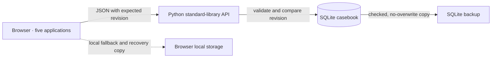

# Northstar · ICT Engineering Portfolio

**Five interactive ICT operations applications that show how an engineer investigates, decides, verifies, and records the outcome.** This recruiter-facing casebook combines infrastructure monitoring, security response, IT service management, network fault isolation, and maintenance change control in a responsive web interface.

The applications run on synthetic scenarios. Their workflows write to a local Python API and SQLite casebook so investigation notes, handoffs, decisions, recovery evidence, and revisions can be inspected after reload. They do not connect to real infrastructure.

**Human-directed, AI-implemented:** the owner selected the project and set its engineering principles. Luna 6 High implemented the original build; Codex Cloud completed the improvement cycles described below.

<p align="center"><a href="docs/screenshots/final-cycle/homepage-desktop.jpg"></a></p>

<p align="center"><strong>Current application · desktop · synthetic casebook saved to local SQLite</strong></p>

## What the portfolio demonstrates

Each lab presents a concrete operational situation, guided investigation, constrained decision, and recorded evidence. Use the left navigation or the casebook cards to open each application.

| Application | Engineering work shown |
| --- | --- |
| **Infrastructure Health Monitor** | Correlate host and availability signals, document a cause hypothesis and action, then close an incident only after a recovery check. |
| **Security Findings Dashboard** | Consider exposure and business impact, assign an owner, document a response plan, and resolve only with verification evidence. |
| **IT Helpdesk Ticket System** | Capture impact, assign ownership, track illustrative first-response targets, preserve work notes, and confirm resolution with the requester. |
| **Network Fault Isolation Tool** | Compare client, gateway, DNS, and upstream checkpoints; identify a likely fault boundary and hand findings to a ticket. |
| **Maintenance Approval & Rollback** | Gate change approval on readiness evidence, confirm the window and baseline, record validation, and document recovery after a failed check. |

### Real browser captures

These screenshots were captured from the running application in headless Chromium against a temporary SQLite database. The records and people shown are fictional. The full-resolution image opens when selected.

| Infrastructure recovery | Security remediation |
| --- | --- |
| [](docs/screenshots/final-cycle/health-recovery.jpg) | [](docs/screenshots/final-cycle/security-remediation.jpg) |

| Helpdesk ownership and response | Network fault isolation |
| --- | --- |
| [](docs/screenshots/final-cycle/helpdesk-first-response.jpg) | [](docs/screenshots/final-cycle/network-isolation.jpg) |

| Maintenance recovery |
| --- |
| [](docs/screenshots/final-cycle/maintenance-rollback.jpg) |

#### Responsive view


## How the project was made

The work began with a single owner prompt: “Build me something that someone hiring an ICT engineer might find impressive.” Prompt Perfect structured the request for the owner’s custom-configured Designer. Designer applied the owner’s engineering principles and proposed project options; the owner selected the ICT Engineering Portfolio. **Luna 6 High implemented the original applications. Codex Cloud performed the later engineering work.**

| Stage | Work | Time |
| --- | --- | --- |
| Original build · Luna 6 High | Implemented the five application simulations and initial portfolio. This work is separate from the improvement-cycle budget. | Original build |
| Frontend improvement · Codex Cloud | Refined recruiter-facing presentation, application workflows, responsive layouts, and accessibility. | 3 hours, as recorded by the owner |
| Backend improvement · Codex Cloud | Added the local API, SQLite persistence, revision-aware writes, retained history, restore, and verified backups. | 3 hours, as recorded by the owner |
| Final engineering refinement · Codex Cloud | Corrected client/API ticket-validation gaps, captured and integrated the finished app states, and refreshed the README and evidence. | See the measured duration in [final-cycle verification](docs/verification.md) |

The owner directed the project, chose the solution, and reviewed the work. Source-code authorship is attributed to the AI systems that implemented each stage; this README does not represent the code as personally hand-written by the owner.

## Architecture

The project keeps a small, dependency-free architecture: vanilla JavaScript in the browser, a Python standard-library server, and a local SQLite file. Browser storage preserves a recovery copy if the local API is unavailable. The server listens on loopback only.



| Area | Implementation |
| --- | --- |
| Frontend | No-build HTML, responsive CSS, and vanilla JavaScript; `src/model.js` owns fixtures and domain transitions, while `src/app.js` renders workflows and synchronizes state. |
| API | `scripts/serve.py` serves same-origin static assets and JSON endpoints on `127.0.0.1:4173`. It validates host, request framing, payload size, and casebook invariants. |
| Persistence | SQLite stores the active casebook and up to 25 consecutive snapshots. Compare-and-swap revisions reject stale writes; restore creates a new revision and records its source. |
| Recovery | `scripts/backup_demo_state.py` checks database integrity and history consistency, then creates a permission-restricted backup without overwriting an existing destination. |
| Dependencies | Python standard library and Node built-ins for the app and tests. No install step, framework, hosted database, or external service. |

## Verification

The checks below were run locally; there is no GitHub Actions pipeline configured for this repository.

- `npm test` — **17 JavaScript model tests and 65 Python API/server tests** pass.
- `npm run check` — JavaScript syntax checks pass; `python3 -m py_compile scripts/serve.py scripts/backup_demo_state.py` passes.
- **Chromium workflow check** — exercised an infrastructure investigation and recovery, security triage and evidence-backed resolution, helpdesk ticket creation and first response, network diagnosis with ticket handoff, and the maintenance approval-to-rollback path. Each saved state was read back from the temporary SQLite API.
- **Responsive browser check** — opened all six routes at 320, 390, 768, and 1440 CSS px (24 route/width combinations); none overflowed. A further 18 checks at 320, 390, and 1440 px found one heading per route and no visible controls without an accessible name. Keyboarding to the skip link focused the main content. This is a focused check, not a formal accessibility audit; prior route and interaction evidence is in [verification.md](docs/verification.md).
- **Recovery check** — a stale write returned HTTP 409 without changing revision 13; restoring revisions 12 and 13 created revisions 14 and 15; `/api/health` matched the 15-row history head. A backup passed `PRAGMA integrity_check`, retained all 15 history rows and the rolled-back case, and had POSIX mode `0600`.
- **Browser errors and external requests** — none observed in the final capture/workflow run.

See the [verification record](docs/verification.md) for test scope, browser steps, prior-cycle evidence, and limits. See the [screenshot gallery](docs/screenshots.md) for all current captures and selected earlier views.

## Run the demo locally

Requirements: Python 3.10+ and Node.js 20+. No package installation is needed.

```sh
npm test
npm run check
npm start
```

Open <http://127.0.0.1:4173>. Route directly to an app with `#health`, `#security`, `#helpdesk`, `#network`, or `#maintenance`. The default SQLite file lives outside the repository at `~/.local/share/northstar-ict-portfolio/demo.sqlite3`; `ICT_PORTFOLIO_DB` can select another path. For backup, restore, API examples, and the private SSH-tunnel workflow, see [backend operations](docs/backend-operations.md).

## Scope and limitations

All names, findings, assets, requests, metrics, checks, and change outcomes are synthetic. Health changes, security remediation, network diagnostics, service-desk actions, and change control are simulations: there are no real probes, scans, notifications, external integrations, or infrastructure actions.

The local SQLite casebook is intended for a single operator and a private demo. The server has no authentication or multi-user authorization and must not be exposed publicly. History is bounded and stored in the same database; it is a recovery feature, not an immutable audit log. Browser verification is not a formal WCAG audit, a production acceptance test, or a cross-browser compatibility matrix.

## Project notes

- [Engineering case studies](docs/case-studies.md) — problem, investigation, decision, verification, and lesson for each scenario.
- [Final-cycle screenshots](docs/screenshots.md) — real captures from the running application.
- [Verification record](docs/verification.md) — exact tests, browser evidence, and known scope limits.
- [Backend operations](docs/backend-operations.md) — local data, backups, revisions, restore, and safe VPS viewing.
