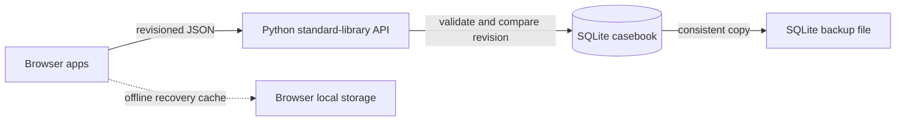

# Northstar · ICT Engineering Portfolio

A recruiter-facing casebook with five interactive ICT operations simulations. Each application walks through a synthetic scenario from signal or request, through investigation and decision, to a recorded outcome. The frontend is a no-build vanilla JavaScript app; a small Python standard-library server provides a same-origin API and SQLite persistence. No application packages, cloud services, or production integrations are used.

## Run locally

Requires Node.js 20+ for automated tests and Python 3.10+ for the local server. No install step is needed.

```sh
npm test
npm run check
npm start
```

Open <http://127.0.0.1:4173>. The server binds to loopback and validates supplied Host values against `localhost` and `127.0.0.1` (HTTP/1.0 clients without a Host header remain usable). It serves only application and documentation assets, blocks hidden workspace paths, disables directory listings, and exposes `/api/state` for the synthetic casebook snapshot. Host validation reduces DNS-rebinding exposure for this unauthenticated local demo; it does not make the server suitable for public exposure. Static and API responses include a same-origin Content Security Policy, MIME-sniffing and framing protections, and a no-referrer policy. SQLite state defaults to `~/.local/share/northstar-ict-portfolio/demo.sqlite3`; set `ICT_PORTFOLIO_DB` to choose another file. Existing V2 browser data is imported on the first run when the database is empty. The browser keeps a local cache and falls back to it if the API is unavailable.

The overview links to each application. For a direct local route, append `#health`, `#security`, `#helpdesk`, `#network`, or `#maintenance` to that address.

## Backing up the casebook

Create a consistent SQLite backup outside the repository. On POSIX systems the backup file is restricted to its owner (`0600`). The command verifies SQLite integrity and snapshot/history consistency in a temporary file, then publishes the complete backup atomically. The destination must be new; an existing backup is never overwritten.

```sh
python3 scripts/backup_demo_state.py ~/.local/share/northstar-ict-portfolio/casebook-backup.sqlite3
```

To restore a backup, stop the server first, keep a copy of the current database, copy the backup to the configured database path, and restart the server. For the default path:

```sh
mv ~/.local/share/northstar-ict-portfolio/demo.sqlite3 ~/.local/share/northstar-ict-portfolio/demo-before-restore-$(date -u +%Y%m%dT%H%M%SZ).sqlite3
cp ~/.local/share/northstar-ict-portfolio/casebook-backup.sqlite3 ~/.local/share/northstar-ict-portfolio/demo.sqlite3
```

If `ICT_PORTFOLIO_DB` points elsewhere, use that path for both commands. These files contain synthetic portfolio data.

## Inspecting and restoring revisions

The API retains the 25 newest accepted snapshots. On the VPS or through the SSH tunnel, inspect the list and a specific revision with:

```sh
curl -fsS http://127.0.0.1:4173/api/history | python3 -m json.tool
curl -fsS http://127.0.0.1:4173/api/history/6 | python3 -m json.tool
```

To restore revision 6 when the current head is revision 8, send the current head and source revision. Replace those example numbers with values from your history response:

```sh
curl -fsS -X POST http://127.0.0.1:4173/api/restore \
  -H 'Content-Type: application/json' \
  -d '{"revision":8,"sourceRevision":6}' | python3 -m json.tool
```

The restore becomes revision 9 and records that it came from revision 6. If another client changes the casebook first, the request returns HTTP 409 and leaves the newer state intact. Reload the portfolio in any open browser to load the restored server snapshot. Revision restore is an API operation; the portfolio does not expose a restore button.

## Viewing from a VPS

With your GitHub SSH key authorized for the private repository, clone the `development` branch on the VPS and run `npm start` there:

```sh
git clone --branch development git@github.com:mylo123ai-hue/ict-engineering-portfolio.git
cd ict-engineering-portfolio
npm start
```

The server deliberately listens on `127.0.0.1:4173`. From your own computer, create an SSH tunnel:

```sh
ssh -N -L 4173:127.0.0.1:4173 your-user@your-vps
```

Then open <http://127.0.0.1:4173> on your computer. Keep the SSH session open while browsing. The preview has no authentication and must remain on loopback; do not bind it to a public interface or open its port in a firewall.

## The five applications

| Application | Engineering evidence | Demonstration |
| --- | --- | --- |
| Infrastructure Health Monitor | Correlate threshold signals, record a likely cause and action, verify recovery against service metrics | Investigate an alert, then record a recovery check |
| Security Findings Dashboard | Prioritise exposure and impact; assign ownership and a response plan; close only with verification evidence | Triage or resolve a synthetic finding |
| IT Helpdesk Ticket System | Capture requester impact, assign ownership, track a priority-based response target, maintain work notes and valid lifecycle transitions | Create a ticket or progress a queued request |
| Network Fault Isolation Tool | Move from impact scope through client, gateway and service checks; distinguish local, DNS and upstream fault domains | Run a diagnostic and hand the findings to the service desk |
| Maintenance Approval & Rollback | Gate approval on readiness evidence; document impact, validation, implementation decision and recovery path | Review a change, validate it, or route failure into rollback |

All actions are simulations. They update the local SQLite casebook and browser cache; they never contact infrastructure or real users. Revision checks detect concurrent edits. On a conflict or outage, the browser keeps an unsynced local snapshot and offers a JSON backup, a safe retry using the last acknowledged revision, and a confirmed option to use the current server copy.

## Engineering case studies

See [the case studies](docs/case-studies.md) for the problem, investigation, decision, verification and lesson represented by each scenario. [Verification evidence](docs/verification.md) records the checks actually run and their limits. The [before-and-after screenshot gallery](docs/screenshots.md) shows the recruiter-facing redesign and all five applications.

## Architecture and limits



The frontend is a no-build vanilla JavaScript single-page interface: `src/model.js` owns synthetic fixtures and domain transitions, `src/app.js` renders workflows and synchronizes the local casebook, and `src/styles.css` provides the responsive design system. `scripts/serve.py` serves the static assets and a same-origin JSON API using Python's standard library; `sqlite3` persists the current casebook and a bounded history of the 25 newest accepted revisions. The database is stored outside the repository by default. Tests use Node's and Python's standard libraries; there are no installed application packages.

All names, alerts, metrics, findings, tickets, changes and outcomes are fictional. Diagnostic results are rule-based examples, not live probes. SQLite persistence is local to the server and intended for a single operator or a private SSH-tunneled demo. There is no authentication, authorization, multi-user account model, cloud backup, integration, real notification, or operational control plane. Do not expose the preview server publicly.

### API contract

- `GET /api/state` returns `{ "state": null, "revision": 0 }` for a new database, or the current snapshot and revision. Persisted snapshots are revalidated on read and checked against the active history record in one SQLite read transaction; invalid or mismatched stored state returns `503` rather than reaching the browser.
- `PUT /api/state` accepts `{ "state": <casebook>, "revision": <expected revision> }` as UTF-8 JSON. Requests and stored snapshots are capped at 1 MB and checked against core casebook fields, workflow gates, and consistency between monitored health, the displayed synthetic thresholds, and investigation status. A worked ticket needs an assigned owner, first-response time, and meaningful work note; a new ticket cannot claim a first response. Change decisions and outcomes need corresponding evidence entries, and high-risk approvals need an independent reviewer distinct from the change owner. Cross-application ticket asset and change-to-finding links must refer to records in the casebook. Integer values across the snapshot, including extension fields, must stay within JavaScript's exact integer range. The active snapshot and history record commit in one SQLite transaction. Stale writes return `409 Conflict`, leaving the browser's unsynced copy available for recovery.
- `GET /api/history` lists the 25 newest retained revisions with UTC timestamps, record counts and restore lineage. `GET /api/history/{revision}` reads a retained snapshot; corrupted or invalid stored history returns `503`.
- `POST /api/restore` accepts `{ "revision": <expected current revision>, "sourceRevision": <retained revision> }`, with a 4 KiB request-body cap. It checks the expected head, reads the source and writes the new revision in one SQLite transaction. A stale restore returns `409`; an expired or unknown source at the current head returns `404`; a retained source that fails stored-state validation returns `503`.
- Existing databases are upgraded in place by seeding their current saved snapshot into the new history table; revisions from before this upgrade cannot be reconstructed. SQLite `user_version` is set to schema version 2; startup refuses a database marked with a newer schema, and every casebook API operation fails closed if the schema version later changes while the server is running.
- `/api/health` reports the current revision, schema version, retained-history count and configured limit. It validates every retained record and confirms the active snapshot matches the newest history entry; corrupt history returns `503` and blocks further writes/restores until repaired. Malformed JSON or ambiguous/unsupported request headers and framing return `400`, invalid state shape returns `422`, oversized bodies return `413`, unsupported media types return `415`, and SQLite storage failures return `503`.

The revision history is a recovery aid rather than an immutable security audit log: it is stored in the same local SQLite file, retains only the 25 newest consecutive snapshots, and can be changed by an operator with filesystem access. The database backup command checks SQLite integrity, the retained records and the active/history head relationship, and includes both tables.

## Personalizing the portfolio

This build intentionally uses a generic demo operator and fictional case studies. Before presenting it as your own job application portfolio, add your identity and only verified, non-sensitive work samples. Keep the simulated cases clearly labeled and do not describe them as incidents or changes from your employment history.
