# ICT Engineering Portfolio

**Five interactive ICT operations applications, built as a human-directed AI project.** The portfolio demonstrates practical engineering decisions across infrastructure, security, service desk, network troubleshooting, and change control.

Prompt Perfect structured the original request. Designer applied the configured engineering principles and presented project options. The owner selected this portfolio; Luna 6 High implemented the original project and prior improvements. Codex Cloud is completing the final engineering refinement recorded below. The AI systems implemented the code; the owner directed the project and selected its scope.

**Vanilla JavaScript · Python standard library · SQLite · five applications · synthetic scenarios only**

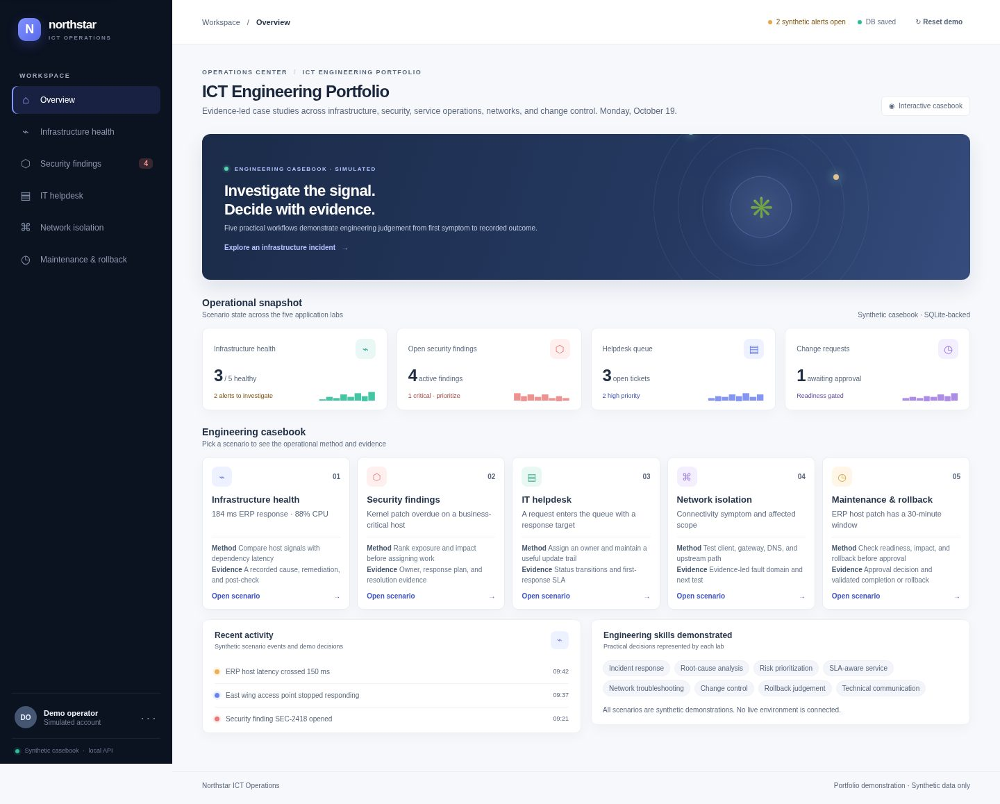

## The applications

Each lab follows a realistic decision path: interpret a signal or request, gather evidence, select an action, and record the result. The data and outcomes are synthetic; no lab connects to live systems.

| Application | What it demonstrates |
| --- | --- |
| **Infrastructure Health Monitor** | Correlate service and host signals, record a cause and action, then verify recovery. |
| **Security Findings Dashboard** | Prioritize by exposure and impact, assign an owner, and close with remediation evidence. |
| **IT Helpdesk Ticket System** | Capture impact, assign a ticket, track first response, and enforce lifecycle and resolution evidence. |
| **Network Fault Isolation Tool** | Test client, gateway, DNS, and upstream boundaries; hand findings to the service desk. |
| **Maintenance Approval & Rollback** | Gate approval on readiness, confirm the window, validate the change, and record recovery when checks fail. |

## Screenshots

These are optimized captures from the running application in headless Chromium, using the local Python API and synthetic SQLite casebook. They show the application itself, including two workflow outcomes.

### Application views

| Infrastructure health | Security findings |
| --- | --- |
| 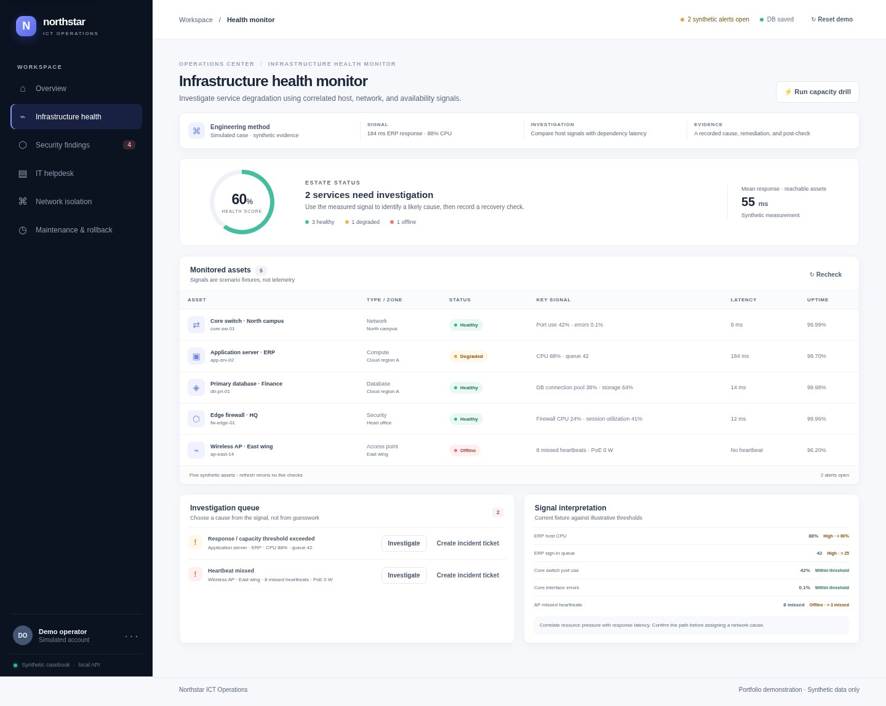 | 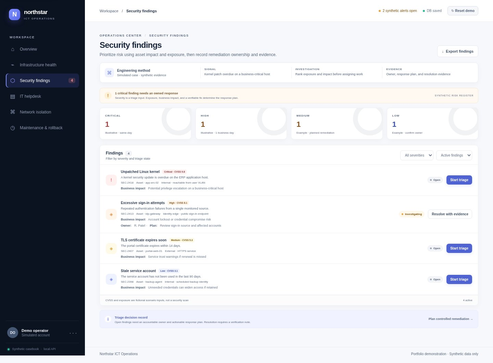 |

| IT helpdesk | Network fault isolation |
| --- | --- |
| 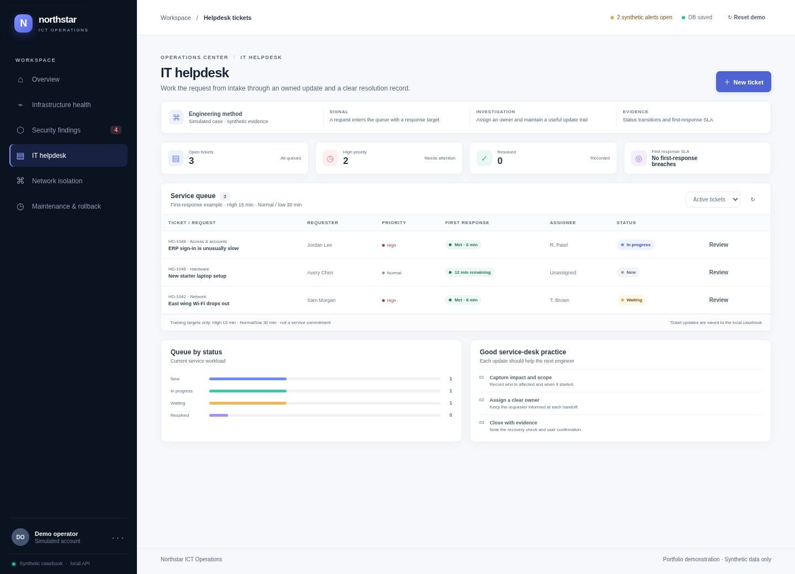 | 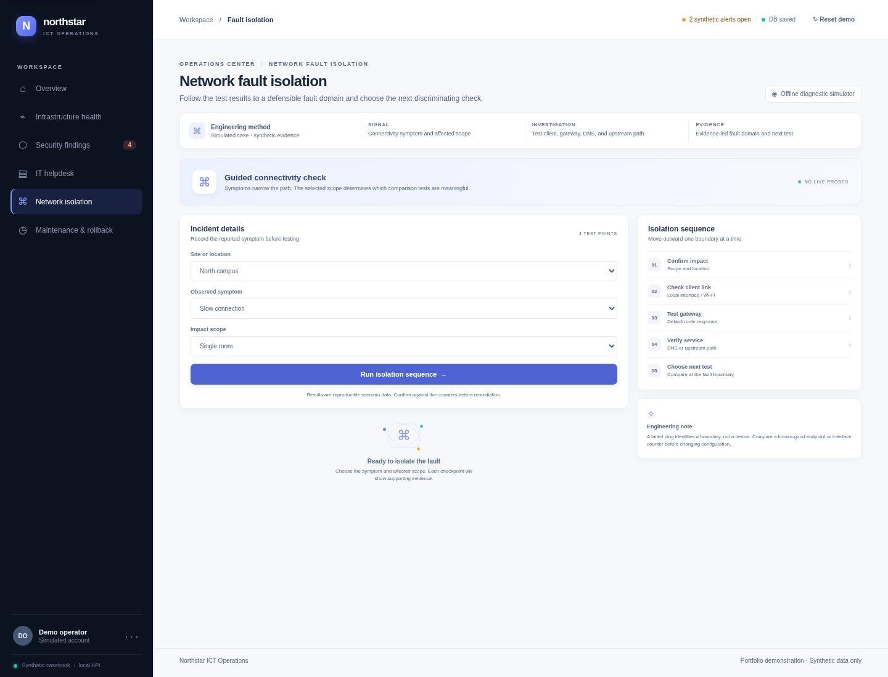 |

| Maintenance approval and rollback | Mobile homepage |
| --- | --- |
| 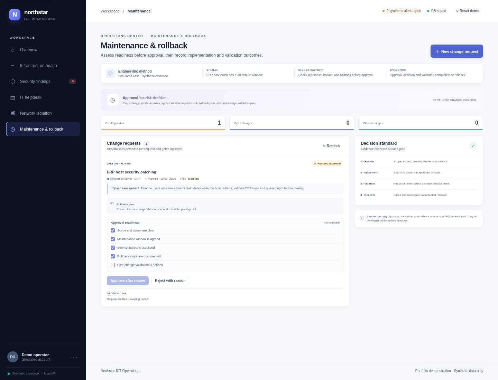 | 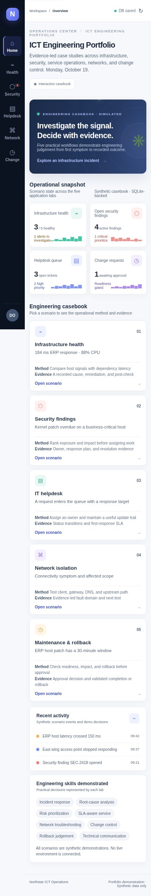 |

### Mobile application view

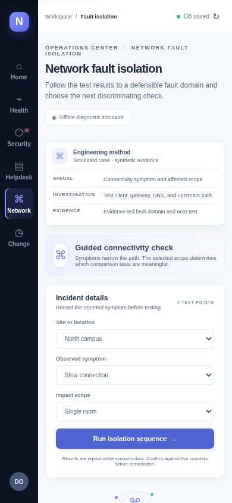

### Workflow evidence

| Multi-site packet-loss diagnosis | Change failure and recorded rollback |
| --- | --- |
| 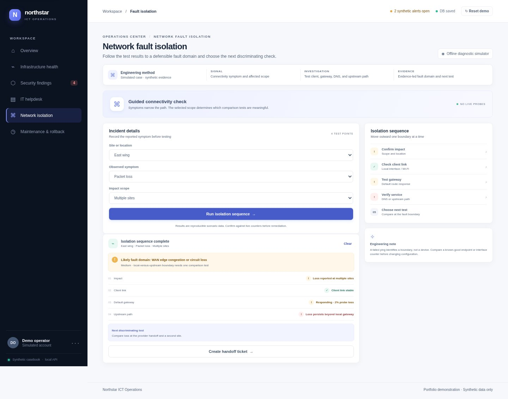 | 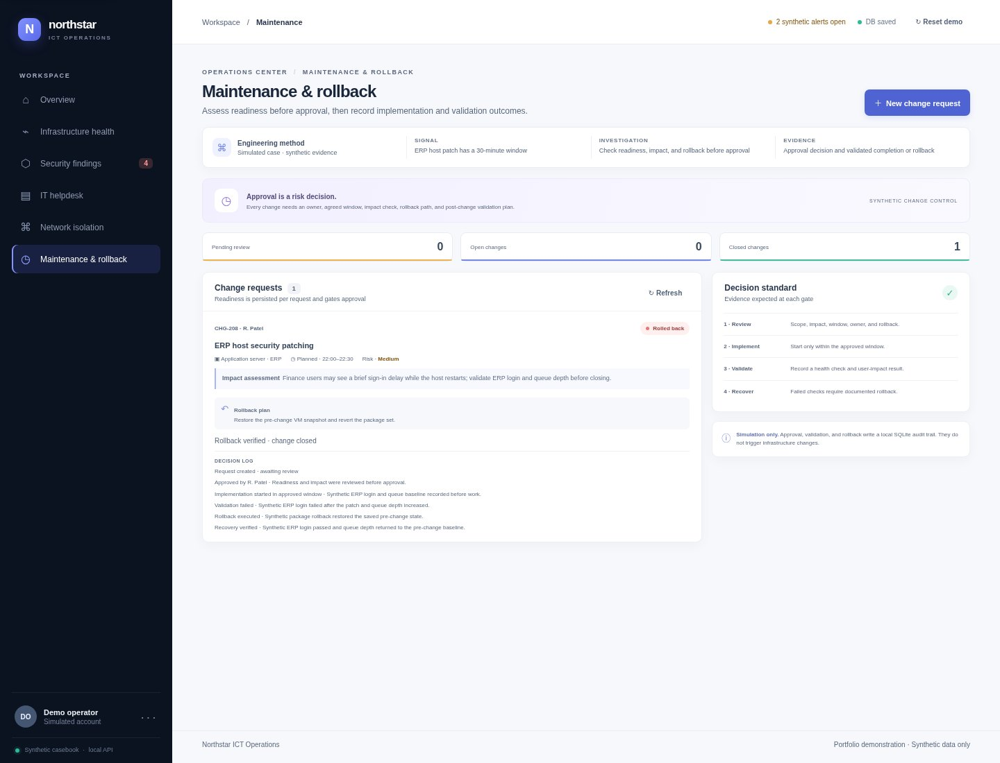 |

All names, requests, hosts, alerts, findings, metrics, timestamps, and outcomes shown in these images are fictional.

## Engineering approach

The project keeps a small, inspectable architecture and places validation at both the browser and API boundaries.

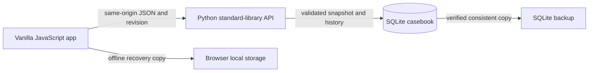

- Domain transitions and synthetic fixtures live in `src/model.js`; `src/app.js` renders the workflows and synchronizes state; `src/styles.css` supplies the responsive interface.
- The Python server validates casebook shape and workflow gates, compares revisions before writes, and commits the snapshot and bounded revision history atomically.
- Stale edits return `409 Conflict`. The browser keeps an unsynced recovery copy and offers deliberate retry, download, or server-copy actions.
- Revision history can be inspected and restored through the local API. The backup utility verifies integrity and history consistency before publishing a new backup file.
- Keyboard navigation, labeled controls, focus-managed dialogs, reduced-motion support, and narrow-screen layouts are included. Browser checks found no horizontal overflow across the six routes at 320, 390, 768, and 1440 pixels; this is not a formal accessibility audit.

The SQLite file is outside the repository by default. The server binds to `127.0.0.1` and has no authentication. Keep it local or use a private SSH tunnel; it is not a public service. Scenarios are rule-based examples, not monitoring, security scanning, or network probes.

## Architecture and local run

Requires Python 3.10+ and Node.js 20+ for the test commands. There are no application dependencies to install.

```sh
npm test
npm run check
npm start
```

Open <http://127.0.0.1:4173>. Direct routes are `#health`, `#security`, `#helpdesk`, `#network`, and `#maintenance`. Set `ICT_PORTFOLIO_DB` to select a different SQLite file.

See [case studies](docs/case-studies.md) for the decisions modeled in each lab, the [screenshot gallery](docs/screenshots.md) for individual captures, and the [verification record](docs/verification.md) for checks and limitations.

## Verification evidence

The current final-cycle build passes:

- `npm test`: 22 Node model tests and 65 Python API/preview tests.
- `npm run check`: syntax checks for both JavaScript modules.
- Chromium checks across five application workflows, responsive routes, mobile dialogs, contrast samples, and browser/API validation agreement. SQLite persistence, revision restore, stale-write conflict, and backup results are recorded in [verification evidence](docs/verification.md).

The test suite uses built-in Node.js and Python libraries. Browser automation used the environment-provided Playwright and Chromium; neither was added as an application dependency.

## Project timeline and attribution

| Stage | Time | Work and attribution |
| --- | --- | --- |
| Prompt and selection | Not recorded | Prompt Perfect structured the request; Designer presented options using the configured engineering principles; the owner selected this portfolio. |
| Original implementation | Separate from the improvement budget | Luna 6 High implemented the original project. |
| Frontend refinement | 3 hours | First completed improvement cycle, directed by the owner. |
| Backend engineering | 3 hours | Second completed improvement cycle, directed by the owner. |
| Final engineering refinement | In progress · up to 4 hours | Codex Cloud work on branch `final-cycle/codex-engineering-polish`; elapsed time and completed changes are tracked in the verification record. |

The improvement budget is six completed hours plus the measured final-cycle time. The original build is separate. The four-hour final-cycle ceiling is not rounded up.

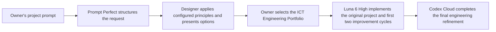

The owner set the direction and selected the project. The named AI systems implemented the code attributed to their stages.

## Limits

This is a private, local portfolio demonstration, not an operational control plane. It has no authentication, authorization, live infrastructure integrations, real notifications, or cloud persistence. All operational scenarios and test records are synthetic. No repository visibility change, merge, website publication, or external service deployment is part of this work.
