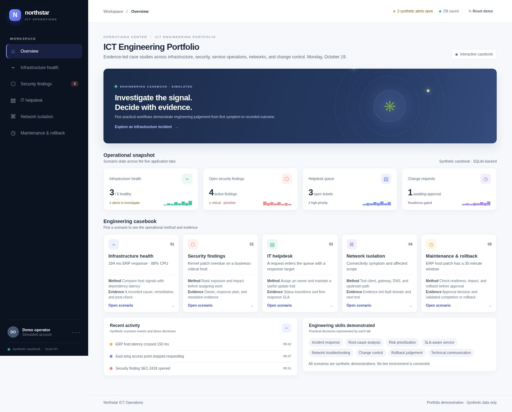
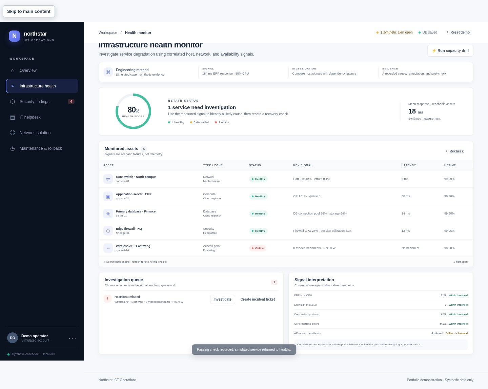
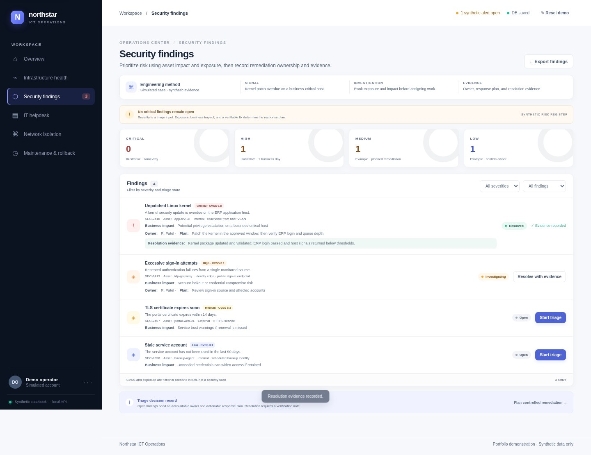
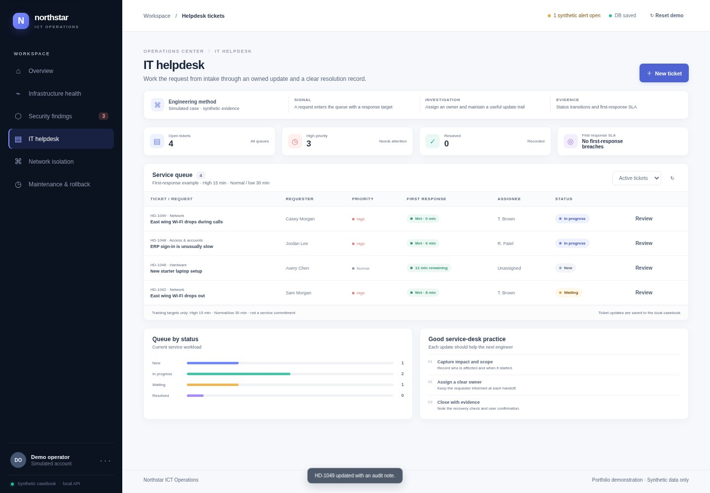
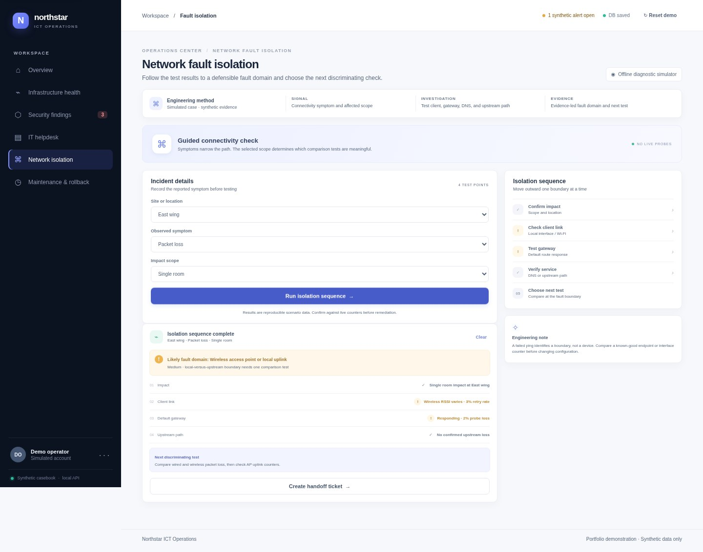
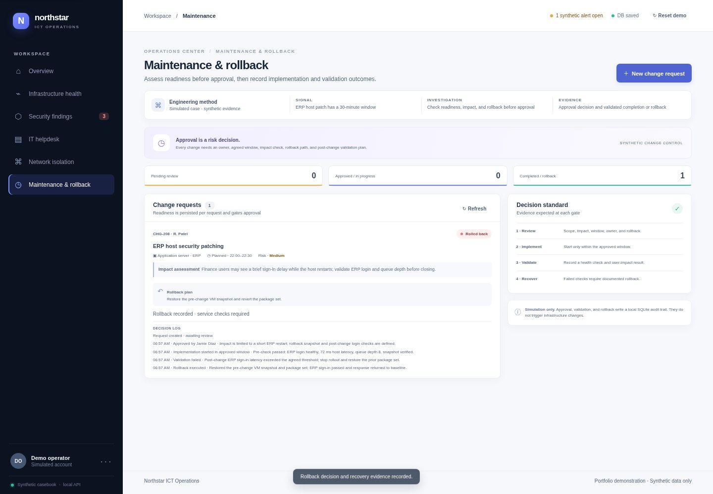
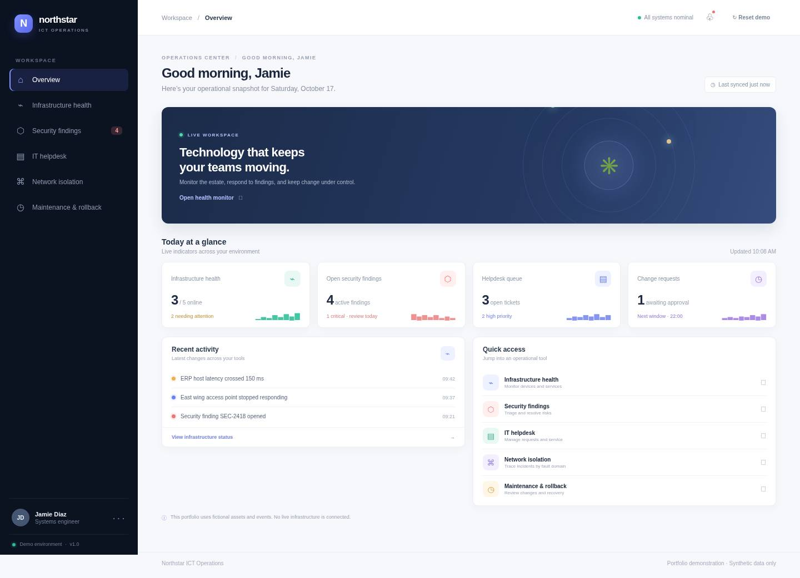
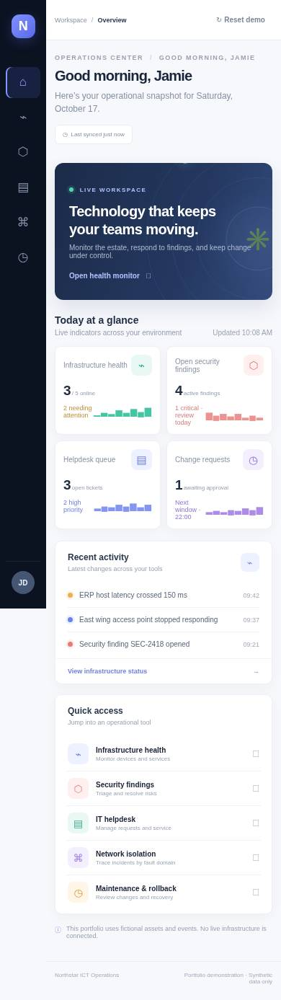
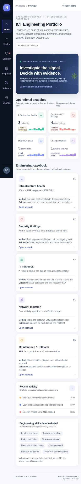

# Portfolio screenshot gallery

The final-cycle screenshots below were captured in real headless Chromium from the running application, using an isolated temporary SQLite database and synthetic casebook records. They are not mockups or generated interface art. The server remained on `127.0.0.1`; no external hosts were contacted.

## Portfolio overview

| Desktop · 1440 px | Mobile · 390 px |
| --- | --- |
|  |  |

## Application workflow states

Each view shows a completed, saved synthetic workflow, not a real production incident or change.

### 1. Infrastructure Health Monitor

ERP host investigation is resolved after recording a post-action check. The separate East wing access point alert remains open, reflecting the scenario rather than falsely marking the entire estate healthy.

### 2. Security Findings Dashboard

SEC-2418 includes an assigned owner, remediation plan, resolved state, and verification evidence. Other synthetic findings remain in the risk register.

### 3. IT Helpdesk Ticket System

HD-1049 is assigned and in progress. Its first response, work note, priority, and response target are shown in the queue.

### 4. Network Fault Isolation Tool

The East wing packet-loss scenario compares impact, client link, gateway, and upstream path. The UI presents a likely local wireless fault domain and the next discriminating test; it makes no live probes.

The browser workflow also handed the diagnostic evidence to a new helpdesk ticket; the created ticket and evidence were read back from SQLite.

### 5. Maintenance Approval & Rollback

CHG-208 passes readiness review, starts within its approved window, fails post-change validation, then records restoration and a passing recovery check.

## Earlier before-and-after homepage captures

The earlier files below are retained to show the recruiter-facing frontend redesign from the previous improvement cycle. They are separate from the final-cycle browser captures above.

| Baseline desktop | Previous-cycle desktop |
| --- | --- |
|  |  |

| Baseline mobile | Previous-cycle mobile |
| --- | --- |
|  |  |

Additional prior-cycle captures are available for the [five applications](apps/), the [SQLite-connected homepage](homepage-backend.jpg), and the [backend cycle](homepage-backend-cycle.png). See the [verification record](verification.md) for the steps and limits of each recorded browser check.
