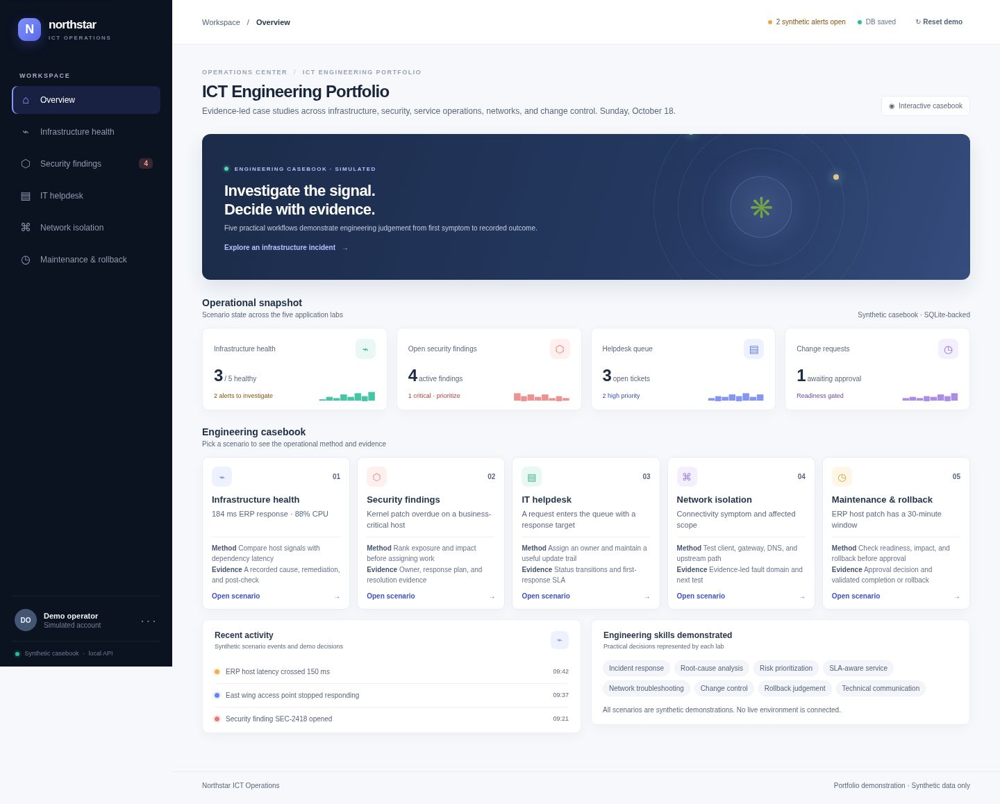

# Portfolio screenshots

The screenshots show the local static demo with synthetic data. They do not represent a deployed or connected service.

## Homepage: baseline and current

The older images are the repository baseline. They show a “live workspace” overview and a nominal status while two synthetic infrastructure alerts are active. The current casebook makes the alert count explicit and presents all five applications with their method and evidence.

### Desktop

| Before | After |
| --- | --- |
|  |  |

### Mobile

| Before | After |
| --- | --- |
|  |  |

## Current backend-connected view

This local capture shows the persistence status after the synthetic casebook was saved to SQLite. It is not a public or VPS deployment.

The current backend-cycle browser pass opened the portfolio through the documented `localhost` host, confirmed SQLite status, and checked all five application routes at desktop and mobile widths.

## Application views

- [Infrastructure Health Monitor](apps/health.jpg)
- [Security Findings Dashboard](apps/security.jpg)
- [IT Helpdesk Ticket System](apps/helpdesk.jpg)
- [Network Fault Isolation Tool](apps/network.jpg)
- [Maintenance Approval & Rollback](apps/maintenance.jpg)

The application views show seeded scenarios. Browser interactions are documented in the [verification record](verification.md).
